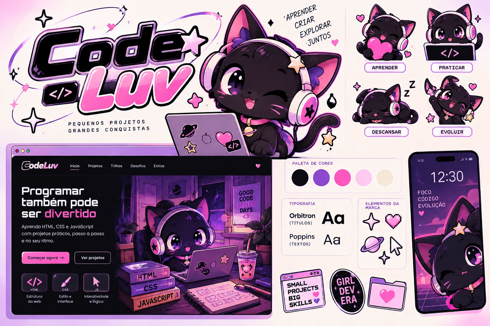

# Briefing — CodeLuv

> **Pequenos projetos, grandes conquistas.**

Documento vivo. Descreve **o que é o produto, para quem, por quê e o que conta como sucesso**. É a fonte da verdade sobre a intenção — tudo o mais no projeto existe para servir ao que está escrito aqui.

> **Regra deste documento:** aqui não entra decisão técnica. Se uma frase só faz sentido para quem programa, ela está no arquivo errado. Cores em código, fontes, componentes e regras de interface ficam no Design System; como construir fica na Arquitetura.

> **Status:** rascunho completo, aguardando revisão.
> **Última revisão:** 2026-10-09 · **Responsável:** Claudio Soares

---

## Como usar este documento

1. **Seções 1 a 4 sustentam as outras.** Mudou o problema, a proposta ou o escopo? Revise o resto.
2. **Nada de placeholder disfarçado.** Seção vaga é pior que seção vazia.
3. **Toda incerteza vai para a seção 14.** Suposição não registrada vira requisito por acidente.
4. **Mudança de ideia vai para a seção 15**, com o porquê.
5. **Atualize o estado abaixo** sempre que mexer numa seção.

### Estado de preenchimento

| #   | Seção                         | Estado   | Responsável    | Revisado em |
| --- | ----------------------------- | -------- | -------------- | ----------- |
| 1   | Resumo                        | rascunho | Claudio Soares | 2026-10-09  |
| 2   | O problema                    | rascunho | Claudio Soares | 2026-10-09  |
| 3   | A proposta                    | rascunho | Claudio Soares | 2026-10-09  |
| 4   | Escopo — o que não é          | rascunho | Claudio Soares | 2026-10-09  |
| 5   | Público                       | rascunho | Claudio Soares | 2026-10-09  |
| 6   | O que o usuário quer resolver | rascunho | Claudio Soares | 2026-10-09  |
| 7   | Casos de uso                  | rascunho | Claudio Soares | 2026-10-09  |
| 8   | Histórias de usuário          | rascunho | Claudio Soares | 2026-10-09  |
| 9   | Jornada                       | rascunho | Claudio Soares | 2026-10-09  |
| 10  | Sucesso e métricas            | rascunho | Claudio Soares | 2026-10-09  |
| 11  | Como impactar positivamente   | rascunho | Claudio Soares | 2026-10-09  |
| 12  | Riscos e premissas            | rascunho | Claudio Soares | 2026-10-09  |
| 13  | Restrições de negócio e marca | rascunho | Claudio Soares | 2026-10-09  |
| 14  | Perguntas em aberto           | rascunho | Claudio Soares | 2026-10-09  |
| 15  | Registro de decisões          | rascunho | Claudio Soares | 2026-10-09  |
| 16  | Vocabulário                   | rascunho | Claudio Soares | 2026-10-09  |
| 17  | Evolução por fases            | rascunho | Claudio Soares | 2026-10-09  |

Estados: `vazio` · `rascunho` · `em revisão` · `acordado`.

---

## 1. Resumo

**Uma frase:**

> O CodeLuv ajuda **quem nunca teve contato com código** a **construir e publicar o próprio site pessoal**, aprendendo HTML, CSS e JavaScript em aulas curtas que **podem ser ouvidas, praticadas na hora e somadas, uma a uma, ao site dela**.

**Em um parágrafo:**

> Hoje, quem quer aprender a programar do zero enfrenta cursos longos, vídeos que se assiste sem praticar e uma preparação de computador que trava antes da primeira linha. O CodeLuv troca isso por aulas de quinze a vinte minutos, em que a explicação pode ser lida ou ouvida na voz da Luv, a mascote, e a prática acontece no mesmo lugar, com o resultado aparecendo na hora. Cada aula acrescenta uma parte ao site pessoal da aluna — primeiro o nome, depois a foto, as cores, o menu, um botão que reage. Ao final, ela não tem um certificado: tem um site no ar, feito por ela, que pode mostrar para qualquer pessoa.

**Se o produto desaparecesse amanhã:** a aluna perderia o caminho guiado, a voz que explica sem pressa e o lugar onde o site dela vai crescendo — voltaria a depender de conteúdo genérico e de perguntar tudo ao parceiro.

**Como uma aluna satisfeita explicaria a uma amiga:** "É tipo um joguinho onde a gatinha me explica as coisas e, no fim de cada aula, meu site fica um pouco mais bonito. Olha ele aqui."

---

## 2. O problema

### 2.1 A situação hoje

Uma pessoa adulta, curiosa, sem nenhuma experiência com código, decide aprender a programar porque convive com alguém da área e quer entender e criar coisas próprias. Ela procura um curso, encontra dezenas de opções com centenas de aulas, começa um vídeo, entende enquanto assiste, mas trava quando precisa fazer sozinha. Precisa instalar programas, criar pastas, descobrir onde digitar. Depois de algumas tentativas, a sensação é de "não sou de exatas" — e o estudo para.

### 2.2 Quem sente a dor

| Quem                | O que dói                                                                       | Com que frequência      | Quanto custa hoje                                             |
| ------------------- | ------------------------------------------------------------------------------- | ----------------------- | ------------------------------------------------------------- |
| A aluna             | Não saber por onde começar; travar no primeiro erro; não ver resultado concreto | A cada sessão de estudo | Desânimo, sensação de incapacidade, abandono                  |
| A aluna             | Ler explicação técnica cansada, à noite, depois do trabalho                     | Na maioria das sessões  | Sessões curtas que rendem pouco; releitura sem fixar          |
| O parceiro (mentor) | Explicar o mesmo conceito várias vezes, sem material de apoio                   | Semanal                 | Tempo, paciência e, às vezes, atrito no relacionamento        |
| O parceiro (mentor) | Não saber em que ponto ela está e o que já entendeu                             | Semanal                 | Ajuda no momento errado, conteúdo repetido ou avançado demais |

### 2.3 Como resolvem hoje

- **Vídeos no YouTube e cursos online genéricos** — muito conteúdo, pouca prática guiada, nenhum acompanhamento.
- **Explicação ao vivo do parceiro** — funciona, mas depende da agenda dele e não fica registrada.
- **"Deixar para depois"** — o concorrente mais forte. Sem um caminho claro e prazeroso, o estudo nunca vira hábito.

### 2.4 Por que resolver agora

Ela quer começar agora, e há um mentor disponível e motivado. Não há mudança de mercado envolvida: o momento certo é o momento pessoal. Quanto mais tempo passar sem um primeiro resultado positivo, mais forte fica a ideia de que "programação não é para mim".

### 2.5 O custo de não resolver

Ela desiste antes de descobrir se gosta. O parceiro continua sendo a única fonte de explicação. A vontade de criar coisas próprias — um site, uma página para um hobby, talvez uma nova carreira — fica sem caminho.

---

## 3. A proposta

### 3.1 O que o produto faz

- Permite que **a aluna ouça cada explicação na voz da Luv**, acompanhando o texto destacado na tela, no ritmo que preferir, para aprender mesmo cansada e sem medo de termos estranhos.
- Permite que **a aluna pratique no mesmo lugar onde aprende**, sem instalar nada, para ver o resultado do que escreveu em segundos.
- Permite que **a aluna construa o próprio site pessoal aos poucos**, uma parte por aula, para terminar o curso com algo real, dela, e não com uma pilha de exercícios soltos.
- Permite que **a aluna erre sem medo**, recebendo uma explicação gentil do que conferir e ajuda progressiva, para transformar erro em aprendizado e não em culpa.
- Permite que **a aluna veja o próprio progresso e celebre conquistas**, para ter motivo de voltar amanhã sem se sentir pressionada.
- Permite que **a aluna publique o site** e compartilhe um endereço, para mostrar o que construiu.
- Permite que **o mentor saiba em que ponto ela está**, para ajudar na hora certa, com o assunto certo.

### 3.2 Por que a nossa forma é melhor que a alternativa atual

| Alternativa de hoje       | Limitação dela                                                   | O que fazemos diferente                                                            |
| ------------------------- | ---------------------------------------------------------------- | ---------------------------------------------------------------------------------- |
| Vídeos e cursos genéricos | Assistir não é fazer; ninguém percebe quando ela travou          | Toda aula termina com prática e resultado visível; o erro é respondido na hora     |
| Cursos com muitas trilhas | Excesso de opção paralisa; resultado final são exercícios soltos | Um único caminho, um único site que cresce aula a aula                             |
| Material só em texto      | Cansa, intimida, exige concentração total                        | A explicação pode ser ouvida, pausada, repetida e acelerada                        |
| Explicação do parceiro    | Depende da agenda dele; não fica registrada                      | O conteúdo está sempre disponível; o mentor entra quando ela realmente precisa     |
| Ambientes de programação  | Preparar o computador vem antes de qualquer resultado            | Prática no navegador desde o primeiro minuto; o "computador de verdade" vem depois |

### 3.3 O princípio inegociável

> **Preferimos que ela entenda devagar a avançar sem entender — mesmo que isso deixe o caminho mais longo e com menos conteúdo.**

Custo aceito: menos aulas, menos tópicos, nenhuma "corrida" para terminar. Nenhuma funcionalidade entra se o efeito dela for fazer a aluna avançar mais rápido do que compreende.

---

## 4. Escopo — o que **não** é

| Não faremos                                           | Por quê                                                                                              | Revisar quando                                                   |
| ----------------------------------------------------- | ---------------------------------------------------------------------------------------------------- | ---------------------------------------------------------------- |
| Ensinar frameworks, bibliotecas ou outras linguagens  | O objetivo é dominar a base (HTML, CSS, JavaScript) que sustenta todo o resto                        | O site pessoal estiver publicado e ela pedir o próximo passo     |
| Atender várias pessoas, turmas ou escolas             | O produto é pessoal; personalização vale mais que escala                                             | Outra pessoa próxima quiser usar e a aluna principal já concluiu |
| Criar contas, login ou cadastro                       | Só existe uma aluna; pedir cadastro é atrito sem benefício                                           | Ela precisar estudar em mais de um aparelho com frequência       |
| Ranking, competição, vidas ou contagem regressiva     | Pressão contradiz o princípio inegociável                                                            | Nunca                                                            |
| Certificado                                           | O resultado que vale é o site publicado                                                              | Ela quiser usar o aprendizado profissionalmente                  |
| Monetização, anúncios, planos pagos                   | Não é um negócio                                                                                     | Nunca, enquanto o produto for pessoal                            |
| Vídeo-aulas gravadas                                  | Custo alto de produção; incentiva assistir em vez de praticar                                        | A escuta da explicação se mostrar insuficiente                   |
| Explicação gerada na hora por inteligência artificial | Conteúdo precisa ser revisado e coerente com o ritmo dela; respostas inventadas confundem iniciantes | O conteúdo base estiver completo e houver forma de revisar       |
| Comunidade, fórum ou chat                             | O mentor já cumpre esse papel                                                                        | Ela quiser trocar com outras pessoas iniciantes                  |

---

## 5. Público

### 5.1 Perfis

**Perfil: a aluna**

- **Quem é:** adulta, usa computador e celular no dia a dia (redes sociais, trabalho, compras), nunca escreveu uma linha de código. Gosta de estética fofa e nostálgica, de personalizar as próprias coisas e de ver resultado rápido.
- **O que quer conseguir:** entender o que o parceiro faz, criar algo próprio na internet e descobrir se programação pode virar algo maior na vida dela.
- **O que a atrapalha hoje:** medo de "não ser de exatas", jargão sem explicação, excesso de conteúdo, preparar o computador antes de começar, cansaço de ler à noite.
- **Como decide se algo é bom:** se entende o que está fazendo, se vê o resultado na hora e se se sente capaz ao terminar.
- **O que a faria abandonar o produto:** sentir-se burra diante de um erro, ficar presa sem saber o que fazer, ou perceber que está "decorando" sem entender.
- **Onde ela está quando usa:** em casa, no notebook, à noite ou no fim de semana; às vezes só ouvindo a explicação no celular antes de praticar.
- **Frequência esperada de uso:** três a cinco sessões por semana, de vinte a quarenta minutos.

**Perfil: o mentor**

- **Quem é:** desenvolvedor experiente, parceiro da aluna, criador do CodeLuv.
- **O que quer conseguir:** que ela aprenda com autonomia e prazer, e que a ajuda dele seja pontual e útil.
- **O que o atrapalha hoje:** repetir explicações, não saber em que ponto ela está, dosar a ajuda sem tirar dela a descoberta.
- **Como decide se algo é bom:** se ela avança sem depender dele a cada passo e se continua animada.
- **O que o faria abandonar o produto:** manter o conteúdo dar mais trabalho que explicar pessoalmente.
- **Onde ele está quando usa:** no computador, revisando o progresso dela ou preparando a próxima aula.
- **Frequência esperada de uso:** semanal.

### 5.2 Quem **não** é público

- Pessoas que já programam e querem se aprofundar.
- Crianças — a linguagem e o visual são divertidos, mas adultos.
- Quem busca certificação ou preparação para entrevista de emprego.
- Escolas, empresas ou turmas.

### 5.3 Relação entre os perfis

O mentor cria e mantém o conteúdo; a aluna consome e pratica. O mentor acompanha o progresso dela e entra quando ela trava. Ninguém paga. O valor para a aluna é **aprender e ter o site dela**; para o mentor, é **vê-la aprender sem precisar explicar tudo** — e, com o tempo, tê-la como colega no próprio projeto.

---

## 6. O que o usuário quer resolver

1. ⭐ Quando **começo uma aula cansada, depois do trabalho**, quero **ouvir a explicação em vez de só ler**, para que eu possa **aprender sem esforço extra e sem me intimidar com palavras técnicas**.
2. ⭐ Quando **escrevo meu primeiro código**, quero **ver na hora o que ele faz**, para que eu possa **ter certeza de que entendi e sentir que sou capaz**.
3. ⭐ Quando **termino uma aula**, quero **ver meu site ficar mais completo**, para que eu possa **sentir que estou construindo algo meu, e não fazendo exercícios soltos**.
4. Quando **erro e não sei por quê**, quero **uma pista do que conferir**, para que eu possa **resolver sozinha antes de pedir ajuda**.
5. Quando **paro de estudar por alguns dias**, quero **voltar exatamente de onde parei**, para que eu possa **não perder tempo nem ânimo procurando**.
6. Quando **não entendi uma explicação**, quero **ouvir de novo, mais devagar**, para que eu possa **entender no meu ritmo sem ter vergonha de repetir**.
7. Quando **concluo uma etapa importante**, quero **ser reconhecida**, para que eu possa **ter vontade de continuar amanhã**.
8. Quando **meu site estiver pronto**, quero **publicá-lo e mandar o link**, para que eu possa **mostrar para as pessoas o que eu fiz**.
9. _(mentor)_ Quando **ela me pede ajuda**, quero **saber em que aula ela está e o que já fez**, para que eu possa **ajudar no ponto certo sem repetir o que ela já sabe**.

⭐ = os três que, sozinhos, já justificam o produto e guiam a primeira entrega.

---

## 7. Casos de uso

### Casos de uso mapeados

| Código | Nome                                 | Perfil | Frequência            | Importância | Estado   |
| ------ | ------------------------------------ | ------ | --------------------- | ----------- | -------- |
| CU-01  | Começar a aprender pela primeira vez | Aluna  | Uma vez               | Essencial   | rascunho |
| CU-02  | Ouvir uma explicação                 | Aluna  | Toda aula             | Essencial   | rascunho |
| CU-03  | Praticar e ver o resultado           | Aluna  | Toda aula             | Essencial   | rascunho |
| CU-04  | Errar e receber ajuda                | Aluna  | Várias vezes por aula | Essencial   | rascunho |
| CU-05  | Ver o site crescer                   | Aluna  | Toda aula             | Essencial   | rascunho |
| CU-06  | Retomar de onde parou                | Aluna  | Toda sessão           | Essencial   | rascunho |
| CU-07  | Celebrar uma conquista               | Aluna  | Semanal               | Importante  | rascunho |
| CU-08  | Publicar o site                      | Aluna  | Poucas vezes          | Importante  | rascunho |
| CU-09  | Acompanhar o progresso da aluna      | Mentor | Semanal               | Importante  | rascunho |
| CU-10  | Preparar uma nova aula               | Mentor | Semanal               | Importante  | rascunho |

**CU-01 — Começar a aprender pela primeira vez**

- **Quem:** aluna
- **Quando acontece:** ela abre o CodeLuv pela primeira vez.
- **Objetivo:** entender o que vai acontecer e fazer algo funcionar logo.
- **Como acontece hoje:** escolhe um curso, assiste à introdução, tenta preparar o computador e trava.
- **Como passa a acontecer:**
  1. A Luv dá boas-vindas e pergunta como ela quer ser chamada.
  2. Em três frases, explica o combinado: aulas curtas, explicação que pode ser ouvida, um site que vai crescer.
  3. Ela começa a primeira aula imediatamente.
  4. Em poucos minutos, vê o próprio nome aparecer numa página escrita por ela.
- **Termina bem quando:** ela vê o nome dela na página que escreveu, em menos de dez minutos.
- **O que pode dar errado:** ela não quer informar o nome (segue sem); o som está desligado (o texto está sempre presente); ela fecha antes de terminar (retoma depois, CU-06).
- **Frequência:** uma vez.
- **Importância:** essencial.

**CU-02 — Ouvir uma explicação**

- **Quem:** aluna
- **Quando acontece:** ao abrir a explicação de uma aula.
- **Objetivo:** entender o conceito sem precisar ler com esforço.
- **Como acontece hoje:** lê textos técnicos, relê várias vezes, desiste.
- **Como passa a acontecer:**
  1. Ela escolhe ouvir.
  2. A Luv lê a explicação; o trecho sendo lido fica destacado na tela.
  3. Ela pode pausar, voltar um trecho, repetir ou mudar a velocidade.
  4. Termos técnicos são pronunciados corretamente e, na primeira vez, explicados.
- **Termina bem quando:** ela chega ao fim da explicação e se sente pronta para praticar.
- **O que pode dar errado:** a pronúncia de um termo em inglês sai estranha; ela está num lugar onde não pode ouvir (lê normalmente); a voz cansa (pode desligar a qualquer momento e a escolha é lembrada).
- **Frequência:** toda aula.
- **Importância:** essencial.

**CU-03 — Praticar e ver o resultado**

- **Quem:** aluna
- **Quando acontece:** depois da explicação e do exemplo.
- **Objetivo:** fazer sozinha o que acabou de aprender.
- **Como acontece hoje:** copia código de um vídeo num programa que não entende bem, sem saber se está certo.
- **Como passa a acontecer:**
  1. Recebe um enunciado em passos curtos.
  2. Escreve o código no mesmo lugar da aula.
  3. Vê o resultado mudar enquanto escreve.
  4. Pede uma conferência e vê, item por item, o que já está certo.
- **Termina bem quando:** todos os itens da conferência estão certos e ela concluiu a aula.
- **O que pode dar errado:** escreve algo que funciona de um jeito diferente do esperado (é aceito, se o resultado for correto); apaga tudo sem querer (pode recomeçar do ponto inicial).
- **Frequência:** toda aula.
- **Importância:** essencial.

**CU-04 — Errar e receber ajuda**

- **Quem:** aluna
- **Quando acontece:** a conferência mostra que algo ainda não está certo.
- **Objetivo:** descobrir o que falta sem se sentir mal.
- **Como acontece hoje:** pergunta ao parceiro ou desiste.
- **Como passa a acontecer:**
  1. Vê qual item ainda não está certo, explicado em linguagem simples.
  2. A Luv encoraja e sugere onde olhar.
  3. Se continuar travada, recebe pistas cada vez mais diretas.
  4. Se quiser, pode ver a solução, sem perder nada.
- **Termina bem quando:** ela resolve — de preferência com uma pista, sem ver a solução.
- **O que pode dar errado:** a pista não ajuda (próxima pista ou solução); ela se frustra (a Luv sugere uma pausa; nada é perdido).
- **Frequência:** várias vezes por aula.
- **Importância:** essencial.

**CU-05 — Ver o site crescer**

- **Quem:** aluna
- **Quando acontece:** ao concluir uma aula.
- **Objetivo:** perceber que o aprendizado virou algo concreto.
- **Como acontece hoje:** exercícios ficam soltos e são esquecidos.
- **Como passa a acontecer:**
  1. O que ela fez na aula passa a fazer parte do site pessoal dela.
  2. Ela vê o site completo até ali, com a parte nova em destaque.
  3. Pode personalizar o conteúdo com as próprias informações e gostos.
- **Termina bem quando:** ela abre o site e reconhece o trabalho dela.
- **O que pode dar errado:** ela quer mudar algo de uma aula antiga (pode refazer ou ajustar a qualquer momento).
- **Frequência:** toda aula.
- **Importância:** essencial.

**CU-06 — Retomar de onde parou**

- **Quem:** aluna
- **Quando acontece:** volta depois de horas ou dias.
- **Objetivo:** continuar sem procurar.
- **Como passa a acontecer:** ao abrir, vê a próxima aula, o código que estava escrevendo e um lembrete curto do que viu na última vez.
- **Termina bem quando:** ela recomeça em menos de um minuto.
- **O que pode dar errado:** usa outro computador ou limpou o navegador (o progresso fica no aparelho; ver seção 14, Q3).
- **Frequência:** toda sessão.
- **Importância:** essencial.

**CU-07 — Celebrar uma conquista**

- **Quem:** aluna
- **Quando acontece:** conclui uma aula marcante, um módulo, ou supera um desafio depois de várias tentativas.
- **Objetivo:** ser reconhecida.
- **Como passa a acontecer:** a Luv comemora, a conquista fica guardada numa coleção que ela pode ver quando quiser.
- **Termina bem quando:** ela se sente orgulhosa e com vontade de continuar.
- **O que pode dar errado:** comemoração exagerada ou frequente demais perde valor (comemorar marcos, não cada clique).
- **Frequência:** semanal.
- **Importância:** importante.

**CU-08 — Publicar o site**

- **Quem:** aluna, com apoio do mentor na primeira vez
- **Quando acontece:** ao concluir os módulos essenciais.
- **Objetivo:** ter o site acessível por um endereço que ela pode compartilhar.
- **Como passa a acontecer:** segue um passo a passo guiado e recebe o endereço do site dela.
- **Termina bem quando:** abre o endereço no celular e vê o próprio site.
- **O que pode dar errado:** precisa criar conta num serviço externo (o mentor acompanha; ver seção 14, Q4).
- **Frequência:** a primeira vez e a cada atualização importante.
- **Importância:** importante.

**CU-09 — Acompanhar o progresso da aluna**

- **Quem:** mentor
- **Quando acontece:** ela pede ajuda ou ele quer planejar a próxima conversa.
- **Objetivo:** saber onde ela está e onde travou.
- **Como passa a acontecer:** ela mostra a tela de progresso (aulas concluídas, onde mais errou, quantas pistas usou).
- **Termina bem quando:** a ajuda dele é sobre o ponto exato em que ela está.
- **Frequência:** semanal.
- **Importância:** importante.

**CU-10 — Preparar uma nova aula**

- **Quem:** mentor (e, no futuro, a própria aluna)
- **Quando acontece:** antes de ela chegar ao fim do conteúdo existente.
- **Objetivo:** ter a próxima aula pronta, com explicação, exemplo, prática e conferência.
- **Como passa a acontecer:** escreve o conteúdo seguindo um formato fixo de aula; o texto passa a poder ser ouvido sem gravação.
- **Termina bem quando:** a aula aparece no caminho dela, completa.
- **Frequência:** semanal.
- **Importância:** importante.

---

## 8. Histórias de usuário

### Histórias mapeadas

| Código | Título                                    | Caso de uso | Prioridade | Estado   |
| ------ | ----------------------------------------- | ----------- | ---------- | -------- |
| HU-01  | Ser recebida pela Luv                     | CU-01       | Essencial  | rascunho |
| HU-02  | Ouvir a explicação com o texto destacado  | CU-02       | Essencial  | rascunho |
| HU-03  | Controlar a escuta                        | CU-02       | Essencial  | rascunho |
| HU-04  | Escrever código e ver o resultado na hora | CU-03       | Essencial  | rascunho |
| HU-05  | Conferir o exercício item por item        | CU-03       | Essencial  | rascunho |
| HU-06  | Receber pistas progressivas               | CU-04       | Importante | rascunho |
| HU-07  | Ver o site pessoal atualizado             | CU-05       | Essencial  | rascunho |
| HU-08  | Continuar de onde parou                   | CU-06       | Essencial  | rascunho |
| HU-09  | Ganhar uma conquista                      | CU-07       | Importante | rascunho |
| HU-10  | Publicar o site                           | CU-08       | Importante | rascunho |
| HU-11  | Mostrar o progresso ao mentor             | CU-09       | Desejável  | rascunho |

**HU-01 — Ser recebida pela Luv** _(CU-01)_

> Como aluna, quero ser recebida pelo nome e entender rapidamente como o CodeLuv funciona, para começar sem ansiedade.

- **Critérios de aceite:**
  - Dado que é a primeira vez, quando abro o CodeLuv, então a Luv me dá boas-vindas e pergunta como quero ser chamada.
  - Dado que não quero informar o nome, quando pulo a pergunta, então continuo normalmente e a Luv me chama de forma genérica.
  - Dado que informei o nome, quando volto outro dia, então sou cumprimentada por ele.
- **Fora desta história:** escolher avatar, personalizar a Luv.
- **Prioridade:** essencial.

**HU-02 — Ouvir a explicação com o texto destacado** _(CU-02)_

> Como aluna, quero ouvir a explicação na voz da Luv enquanto vejo o trecho lido destacado, para aprender sem cansar e associar o som à palavra escrita.

- **Critérios de aceite:**
  - Dado que estou numa explicação, quando escolho ouvir, então a leitura começa e o trecho lido fica destacado.
  - Dado que a explicação tem um termo técnico, quando ele é lido, então é pronunciado de forma reconhecível e, na primeira aparição, explicado.
  - Dado que não quero som, quando abro a aula, então o texto está completo e nada toca sozinho.
  - Dado que meu aparelho não consegue reproduzir a voz, quando tento ouvir, então recebo um aviso claro e continuo pelo texto.
- **Fora desta história:** ouvir o código sendo lido símbolo a símbolo; vozes diferentes por personagem.
- **Prioridade:** essencial.
- **Depende de:** Q1 (qualidade da voz em português).

**HU-03 — Controlar a escuta** _(CU-02)_

> Como aluna, quero pausar, voltar um trecho, repetir e mudar a velocidade, para ouvir no meu ritmo.

- **Critérios de aceite:**
  - Dado que estou ouvindo, quando pauso e retomo, então a leitura continua do mesmo ponto.
  - Dado que não entendi um trecho, quando volto, então ele é lido de novo.
  - Dado que mudei a velocidade, quando abro a próxima aula, então a velocidade escolhida é mantida.
  - Dado que estou usando só o teclado, quando quero controlar a escuta, então consigo fazer tudo sem mouse.
- **Prioridade:** essencial.

**HU-04 — Escrever código e ver o resultado na hora** _(CU-03)_

> Como aluna, quero escrever código no mesmo lugar da aula e ver o resultado enquanto escrevo, para entender a relação entre o que digito e o que aparece.

- **Critérios de aceite:**
  - Dado que estou no exercício, quando digito, então o resultado aparece ao lado em cerca de um segundo.
  - Dado que escrevi algo que quebra a página, quando isso acontece, então vejo uma mensagem simples, e nada fora do exercício é afetado.
  - Dado que quero recomeçar, quando peço, então o exercício volta ao ponto inicial.
- **Fora desta história:** salvar várias versões; trabalhar em vários arquivos.
- **Prioridade:** essencial.

**HU-05 — Conferir o exercício item por item** _(CU-03)_

> Como aluna, quero pedir uma conferência e ver o que está certo e o que falta, para saber exatamente quando terminei.

- **Critérios de aceite:**
  - Dado que escrevi uma solução, quando peço a conferência, então cada item aparece como "certo" ou "ainda não", com texto (não só cor).
  - Dado que resolvi de um jeito diferente do exemplo, quando o resultado está correto, então a conferência aceita.
  - Dado que todos os itens estão certos, então consigo concluir a aula.
- **Prioridade:** essencial.

**HU-06 — Receber pistas progressivas** _(CU-04)_

> Como aluna, quero pistas cada vez mais diretas quando travo, para resolver sozinha o máximo possível.

- **Critérios de aceite:**
  - Dado que um item falhou, então vejo uma mensagem de incentivo, nunca "errado".
  - Dado que o mesmo item falhou de novo, quando peço ajuda, então recebo uma pista de onde olhar; na seguinte, uma pista do que escrever.
  - Dado que quero ver a solução, quando peço, então ela aparece sem perda de progresso ou conquista.
- **Prioridade:** importante.

**HU-07 — Ver o site pessoal atualizado** _(CU-05)_

> Como aluna, quero ver meu site pessoal com a parte nova incluída ao concluir uma aula, para sentir que estou construindo algo meu.

- **Critérios de aceite:**
  - Dado que concluí uma aula, então vejo o site completo até aqui, com a novidade destacada.
  - Dado que quero mudar algo de uma aula anterior, quando volto a ela, então a mudança aparece no site.
  - Dado que ainda não concluí nenhuma aula, quando abro o site, então vejo um convite gentil para começar.
- **Prioridade:** essencial.

**HU-08 — Continuar de onde parou** _(CU-06)_

> Como aluna, quero que o CodeLuv lembre onde parei e o que escrevi, para retomar em segundos.

- **Critérios de aceite:**
  - Dado que fechei no meio de um exercício, quando volto, então o código continua lá.
  - Dado que voltei depois de dias, quando abro, então a próxima aula está em destaque com um lembrete do que vi por último.
  - Dado que o progresso não pôde ser recuperado, então recebo uma explicação clara e um caminho para recomeçar, sem acusar erro meu.
- **Prioridade:** essencial.

**HU-09 — Ganhar uma conquista** _(CU-07)_

> Como aluna, quero ser reconhecida ao atingir marcos, para ter vontade de continuar.

- **Critérios de aceite:**
  - Dado que concluí a primeira aula, então recebo a primeira conquista, com a Luv comemorando.
  - Dado que superei um exercício depois de várias tentativas, então sou reconhecida pela persistência.
  - Dado que prefiro menos movimento na tela, então a comemoração aparece sem animação.
- **Fora desta história:** ranking, comparação, conquistas por tempo de uso.
- **Prioridade:** importante.

**HU-10 — Publicar o site** _(CU-08)_

> Como aluna, quero publicar meu site e receber um endereço, para mostrar o que construí.

- **Critérios de aceite:**
  - Dado que concluí os módulos essenciais, quando sigo o passo a passo, então meu site fica acessível por um endereço.
  - Dado que algo falhou no meio, então sei exatamente em que passo parei e como continuar.
- **Prioridade:** importante.
- **Depende de:** Q4.

**HU-11 — Mostrar o progresso ao mentor** _(CU-09)_

> Como aluna, quero uma visão simples do meu progresso, para mostrar ao mentor onde estou quando peço ajuda.

- **Critérios de aceite:**
  - Dado que abro meu progresso, então vejo aulas concluídas, aula atual e onde precisei de mais pistas.
- **Prioridade:** desejável.

---

## 9. Jornada

| Fase                     | O que a pessoa faz                                                           | O que ela sente                        | Onde costuma travar                                 | O que precisa acontecer para dar certo                                       |
| ------------------------ | ---------------------------------------------------------------------------- | -------------------------------------- | --------------------------------------------------- | ---------------------------------------------------------------------------- |
| **Descobre**             | O parceiro mostra o CodeLuv, feito para ela                                  | Curiosidade, carinho, um pouco de medo | "Será que eu consigo?"                              | Visual acolhedor e uma promessa simples: "você vai fazer seu próprio site"   |
| **Decide experimentar**  | Abre sozinha, sem pressão                                                    | Expectativa                            | Medo de parecer burra na frente dele                | Poder começar sozinha, sem ninguém olhando                                   |
| **Primeiro uso**         | É recebida pela Luv, ouve a primeira explicação, escreve as primeiras linhas | Surpresa, alívio                       | Não entender onde digitar                           | Uma única tarefa por vez, com indicação clara                                |
| **Primeiro valor**       | Vê o próprio nome numa página que ela mesma escreveu                         | "Eu fiz isso!"                         | Errar na primeira tentativa                         | **Acontecer em até 10 minutos**, com erro bem acolhido                       |
| **Uso rotineiro**        | Uma aula por sessão; ouve, pratica, vê o site crescer                        | Ritmo, progresso                       | Cansaço, falta de tempo, conteúdo mais difícil (JS) | Aulas curtas, escuta como alternativa à leitura, retomada instantânea        |
| **Momento difícil**      | Trava num exercício, erra várias vezes                                       | Frustração, "não sou de exatas"        | Ficar presa sem saber o que conferir                | Pistas progressivas, incentivo da Luv, solução disponível, mentor como apoio |
| **Continua ou abandona** | Volta porque quer ver o site pronto, ou some                                 | Orgulho, ou desânimo                   | Pausa longa que vira esquecimento                   | Site visível como motivação; conquistas por marcos; nunca punição por pausar |

> **Primeiro valor em até 10 minutos** a partir da primeira abertura: ela escreve uma linha e vê o próprio nome aparecer como título de uma página. Para isso, precisa estar pronto: boas-vindas, a primeira aula completa (com escuta), prática com resultado imediato e conferência.

---

## 10. Sucesso e métricas

### 10.1 Sinal principal

> **Partes do site pessoal construídas por ela.**

Só aumenta quando ela aprende e aplica. Não sobe com tempo de tela nem com cliques.

### 10.2 Medidas de apoio

| O que medimos                            | Por que importa                         | Como saberemos                       | Meta inicial                     |
| ---------------------------------------- | --------------------------------------- | ------------------------------------ | -------------------------------- |
| Tempo até o primeiro valor               | Prova que a promessa se cumpre logo     | Observação na primeira sessão        | ≤ 10 minutos                     |
| Sessões por semana                       | Prova que virou hábito                  | Registro de dias estudados           | ≥ 3 nas primeiras quatro semanas |
| Aulas resolvidas sem ver a solução       | Prova entendimento, não cópia           | Registro de pistas e soluções usadas | ≥ 70% das aulas                  |
| Uso da escuta                            | Valida a aposta no recurso de voz       | Registro de aulas ouvidas            | Usada em ≥ 50% das aulas         |
| Pontos onde ela mais pede pista ou ajuda | Mostra onde o conteúdo precisa melhorar | Registro de pistas + conversas       | Revisar qualquer aula com pico   |
| Site publicado                           | É o resultado prometido                 | Endereço no ar                       | Fase 2                           |

### 10.3 Sinais de que estamos errando

- Ela passa mais de duas semanas sem abrir e não sente falta.
- Ela conclui aulas, mas não consegue explicar com as próprias palavras o que fez.
- Ela vê a solução na maioria das aulas.
- Ela pede ajuda ao mentor tanto quanto antes do CodeLuv.
- Ela nunca usa a escuta — sinal de que o recurso central não é central.
- Ela diz que o site "não parece dela".

### 10.4 O que **não** perseguimos

- Tempo dentro do produto.
- Quantidade de aulas concluídas por semana (pressa contradiz o princípio inegociável).
- Sequência de dias seguidos.
- Número de conquistas.

---

## 11. Como impactar positivamente

### 11.1 Compromissos

| Compromisso           | O que significa na prática                                                                          | Como saberemos que cumprimos           |
| --------------------- | --------------------------------------------------------------------------------------------------- | -------------------------------------- |
| **Clareza**           | Ela sempre sabe o que está aprendendo, o que fazer agora e o que vem depois                         | Ela não pergunta "e agora?"            |
| **Respeito ao tempo** | Aulas curtas; nada pedido que não seja usado; retomada imediata                                     | Sessões de 20–40 min concluem uma aula |
| **Erro sem culpa**    | Erro é tratado como parte do caminho; nunca "errado", "fácil", "óbvio"                              | Ela tenta de novo em vez de desistir   |
| **Reversibilidade**   | Pode refazer qualquer aula, recomeçar um exercício, mudar o site; apagar progresso pede confirmação | Nenhuma perda acidental                |
| **Previsibilidade**   | Toda aula segue o mesmo formato; a Luv sempre aparece no mesmo tipo de situação                     | Ela antecipa o próximo passo           |
| **Discrição**         | Só o nome é pedido, e é opcional; nada sai do aparelho dela                                         | Nenhum dado pessoal compartilhado      |
| **Ritmo próprio**     | Pode pausar dias sem perder nada nem ser cobrada                                                    | Nenhuma mensagem de cobrança           |

### 11.2 Momentos que constroem confiança

- **Primeira linha que funciona** — o nome dela na tela. Precisa ser rápido, bonito e celebrado.
- **Primeiro erro** — a resposta precisa ser gentil, específica e mostrar o que conferir.
- **Primeira vez que ouve uma explicação** — a voz precisa ser agradável, os termos técnicos compreensíveis e o controle óbvio.
- **Primeira volta depois de uma pausa** — tudo exatamente onde ela deixou.
- **Primeira vez que pede a solução** — sem perda, sem julgamento.
- **Primeira publicação** — o endereço abre no celular dela.

### 11.3 O que não faremos para crescer

- Mandar lembretes ou notificações para trazê-la de volta.
- Usar sequências que "quebram" e geram culpa por pausar.
- Esconder a solução para forçar tentativas.
- Comemorar cada clique para inflar a sensação de progresso.
- Pedir dados pessoais além do nome.

### 11.4 Acessibilidade e alcance

- **Escuta como acesso, não enfeite:** a explicação em voz ajuda quem lê com dificuldade, cansa com textos longos ou tem baixa visão.
- **Texto sempre presente:** nada depende só do som; nada toca sozinho.
- **Cor nunca é o único sinal:** certo/ainda não sempre com texto ou ícone.
- **Movimento opcional:** quem prefere menos animação vê as mesmas informações, paradas.
- **Teclado:** tudo, inclusive a escuta, pode ser usado sem mouse.
- **Leitura confortável:** contraste alto, letras legíveis, linhas curtas, apesar do estilo decorativo.
- **Aparelhos:** aprender funciona no celular (ler e ouvir); praticar é pensado para notebook.

---

## 12. Riscos e premissas

### 12.1 Premissas

| Assumimos que…                                                               | Se for falso…                           | Como verificar                                         | Estado         |
| ---------------------------------------------------------------------------- | --------------------------------------- | ------------------------------------------------------ | -------------- |
| Ela quer aprender de verdade, e não só agradar o parceiro                    | O produto vira obrigação e é abandonado | Conversa franca antes de começar; observar a 2ª semana | não verificado |
| Ouvir a explicação ajuda mais do que só ler                                  | O recurso central perde sentido         | Uso da escuta nas primeiras aulas + conversa           | não verificado |
| Uma voz sintética em português é agradável o suficiente                      | A escuta irrita e é desligada           | Testar com a primeira aula antes de produzir as demais | não verificado |
| Construir um site pessoal é motivador para ela                               | O fio condutor não engaja               | Perguntar o que ela gostaria de ter no site            | não verificado |
| Sessões de 20–40 minutos, 3 a 5 vezes por semana, são viáveis na rotina dela | O ritmo planejado não acontece          | Observar as primeiras quatro semanas                   | não verificado |
| O mentor consegue produzir conteúdo no ritmo em que ela consome              | Ela chega ao fim do conteúdo e para     | Ter sempre duas aulas prontas à frente                 | não verificado |

### 12.2 Riscos

| Risco                                                                | Impacto | Probabilidade | O que fazemos a respeito                                                         |
| -------------------------------------------------------------------- | ------- | ------------- | -------------------------------------------------------------------------------- |
| A parte de JavaScript é bem mais difícil e gera abandono             | Alto    | Média         | Aulas ainda menores, mais exemplos visuais, mentor mais presente nessa fase      |
| O relacionamento mistura com o ensino (cobrança, frustração)         | Alto    | Média         | O produto conduz o dia a dia; o mentor entra só quando chamado; nada de cobrança |
| A voz soa robótica ou pronuncia mal termos técnicos                  | Médio   | Média         | Validar na primeira aula; ajustar o texto escrito para ser bom de ouvir          |
| O visual decorado atrapalha a leitura                                | Médio   | Média         | Decoração nunca na área de leitura e prática; legibilidade vence estilo          |
| Ela perde o progresso ao trocar de aparelho ou limpar o navegador    | Médio   | Baixa         | Opção de guardar e recuperar uma cópia do progresso (ver Q3)                     |
| O conteúdo fica pronto mais devagar que o estudo dela                | Médio   | Média         | Começar pelas aulas de HTML completas; manter duas aulas à frente                |
| O projeto cresce além do necessário (recursos "legais", mas sem uso) | Médio   | Alta          | Seção 4 e princípio inegociável como filtro                                      |

---

## 13. Restrições de negócio e marca

- **Prazo:** não há data fixa. A Fase 1 deve estar utilizável antes de ela começar a estudar — o primeiro uso precisa já entregar o primeiro valor.
- **Orçamento:** custo zero ou próximo de zero. Nada que exija assinatura paga para funcionar, inclusive a voz.
- **Legais e regulatórias:** o único dado pessoal é o nome (opcional), que não sai do aparelho dela. Imagens e textos de terceiros usados nas aulas precisam ter uso livre.
- **Contratuais:** nenhuma.
- **Operacionais:** o mentor mantém o conteúdo e dá suporte. Com o tempo, a aluna pode escrever conteúdo também.

### Marca e comunicação

**Nome:** CodeLuv · **Slogan:** "Pequenos projetos, grandes conquistas." · **Frases de apoio:** "Aprender · Criar · Explorar · Juntos", "Small projects, big skills", "Foco · Código · Evolução".

**Logo:** os arquivos fornecidos são a referência e não serão redesenhados — versão só com o nome e versão com a Luv.

**Personalidade:**

| Somos         | Não somos       |
| ------------- | --------------- |
| Acolhedores   | Condescendentes |
| Divertidos    | Infantis        |
| Nostálgicos   | Datados         |
| Encorajadores | Bajuladores     |
| Claros        | Simplistas      |

**Tom de voz:** conversa próxima, em segunda pessoa, frases curtas. Todo termo técnico é explicado na primeira vez. Celebra o esforço, não só o acerto. Palavras proibidas: "errado", "fácil", "simples", "óbvio", "basta". Texto escrito para ser **bom de ouvir** também: frases que soam naturais em voz alta, sem siglas soltas nem parênteses longos.

**Estilo visual — Y2K / Cyber Kawaii / internet retrô:** a estética da internet dos anos 2000 com cuidado de produto atual. Fundo escuro de "quarto gamer à noite", acentos em rosa vibrante e violeta, detalhes em rosa-bebê e creme. Elementos brilhantes e "plastificados", molduras inspiradas em janelas de computadores antigos, corações e cursores pixelados, estrelas de quatro pontas, pequenos planetas, órbitas. Botões e cartões com contorno marcado, como adesivos. Movimentos suaves, como de jogo casual. **Regra:** a decoração mora nas bordas, nas celebrações e nas telas vazias; onde se lê e onde se pratica, o visual é limpo. Diversão sem perder a maturidade.

**Cores, pelo nome:** escuro quase preto (fundo), violeta (marca), rosa vibrante (ação e destaque), rosa-bebê (suavidade), creme (texto e fundo claro). Os valores exatos, a tipografia e as regras de uso ficam no Design System.

**A Luv:** gatinha preta de olhos violeta, fones de ouvido rosa com estrela, coleira rosa com sininho de planeta. É **companheira de estudo**, não professora: lê a explicação em voz alta, encoraja, dá pistas e comemora.

| Momento                       | Como a Luv aparece                |
| ----------------------------- | --------------------------------- |
| Boas-vindas                   | Piscando, com notebook            |
| Abertura de aula / explicação | Abraçando um coração ("aprender") |
| Prática                       | Atrás do monitor ("praticar")     |
| Pista                         | Com a pata levantada              |
| Depois de um erro             | Sorriso suave, encorajando        |
| Conquista                     | Pulando entre estrelas            |
| Pausa / telas vazias          | Dormindo ("descansar")            |
| Fim de módulo                 | Acenando ("evoluir")              |

**Regras da Luv:** uma por tela; nunca bloqueia o que a aluna está fazendo; fala no máximo duas frases por vez; ocupa pouco espaço; pode ser desligada (a escuta continua disponível sem a imagem).

**Promessas que não podemos fazer:** "aprenda a programar em X dias", "vire desenvolvedora", "é fácil".

---

## 14. Perguntas em aberto

| #   | Pergunta                                                                                                                                                                           | Por que importa                                                                     | Quem responde  | Prazo                  | Estado |
| --- | ---------------------------------------------------------------------------------------------------------------------------------------------------------------------------------- | ----------------------------------------------------------------------------------- | -------------- | ---------------------- | ------ |
| Q1  | A voz sintética gratuita em português é boa o bastante, inclusive para termos em inglês?                                                                                           | É o recurso central; voz ruim derruba a aposta                                      | Mentor + aluna | Antes da 2ª aula       | aberta |
| Q2  | O que ela quer ter no site pessoal (seções, temas, gostos)?                                                                                                                        | Define as partes do site e, portanto, a ordem das aulas                             | Aluna          | Antes do roteiro final | aberta |
| Q3  | Ela vai estudar em mais de um aparelho? Precisa guardar uma cópia do progresso?                                                                                                    | Define se só o aparelho basta ou se é preciso uma forma de levar junto              | Aluna          | Fase 1                 | aberta |
| Q4  | Onde o site dela será publicado e com que endereço?                                                                                                                                | Afeta a última etapa da jornada e pode exigir conta em serviço externo              | Mentor         | Fase 2                 | aberta |
| Q5  | Quais outros recursos de aprendizagem valem a pena: código explicado linha a linha, mini-quizzes, revisão periódica dos conceitos, glossário, demonstrações visuais passo a passo? | A escuta é a aposta inicial; outros recursos só entram se o uso mostrar necessidade | Mentor + aluna | Fim da Fase 1          | aberta |
| Q6  | Em que momento ela passa do navegador para um editor "de verdade" no computador?                                                                                                   | Faz parte de se tornar autônoma, mas pode assustar cedo demais                      | Mentor         | Fase 3                 | aberta |
| Q7  | A aluna quer participar da criação do próprio CodeLuv (escrever aulas, ajustar o visual)?                                                                                          | Era um princípio da ideia original; precisa ser vontade dela                        | Aluna          | Fase 3                 | aberta |
| Q8  | A Luv deve ter uma voz própria e reconhecível, ou qualquer voz em português serve?                                                                                                 | Afeta personalidade e custo                                                         | Mentor + aluna | Fase 2                 | aberta |

---

## 15. Registro de decisões

**D-01 — O resultado do aprendizado é um site pessoal, construído aula a aula**

- **Data:** 2026-10-09
- **Contexto:** era preciso um fio condutor que desse sentido a cada aula.
- **Alternativas consideradas:** vários mini-projetos independentes (variedade, mas resultado fragmentado); mini-projetos mais um site final (mais conteúdo para produzir); um único site que cresce (progresso visível e acumulado).
- **Decisão:** um único site pessoal, que ganha uma parte nova a cada aula.
- **Por quê:** ela vê o progresso acumulado num lugar só e termina com algo real e dela.
- **O que abrimos mão:** variedade de projetos e exposição a tipos diferentes de página.
- **Revisar se:** ela perder interesse no tema do site.

**D-02 — A explicação pode ser ouvida na voz da Luv**

- **Data:** 2026-10-09
- **Contexto:** a aluna estuda à noite, cansada, e se intimida com termos técnicos.
- **Alternativas consideradas:** só texto; vídeo-aulas gravadas; leitura em voz alta com destaque do trecho lido.
- **Decisão:** leitura em voz alta, com o trecho destacado e controle de pausa, repetição e velocidade.
- **Por quê:** reduz esforço de leitura sem o custo de gravar vídeos e sem tirar o foco da prática.
- **O que abrimos mão:** a expressividade de uma voz humana gravada.
- **Revisar se:** Q1 mostrar que a voz não é agradável ou compreensível.

**D-03 — Outros recursos de aprendizagem ficam para depois**

- **Data:** 2026-10-09
- **Contexto:** muitos recursos possíveis (código explicado linha a linha, quizzes, revisão periódica, visualizações).
- **Decisão:** começar só com a escuta, além de prática, conferência e pistas; os demais viram pergunta em aberto (Q5).
- **Por quê:** princípio inegociável e escopo enxuto; cada recurso novo precisa de evidência de necessidade.
- **O que abrimos mão:** variedade de formatos desde o início.
- **Revisar se:** o fim da Fase 1 mostrar pontos de dificuldade que um desses recursos resolveria.

**D-04 — A prática acontece dentro do CodeLuv, sem instalar nada**

- **Data:** 2026-10-09
- **Contexto:** preparar o computador é um dos principais motivos de abandono no início.
- **Alternativas consideradas:** praticar num editor instalado no computador; misto (navegador para aulas, computador para projetos); tudo no navegador.
- **Decisão:** toda a prática no próprio CodeLuv, com resultado imediato e conferência automática.
- **Por quê:** primeiro valor em minutos, feedback imediato, nada para configurar.
- **O que abrimos mão:** contato precoce com as ferramentas usadas profissionalmente.
- **Revisar se:** ela estiver pronta para o próximo passo (Q6).

**D-05 — Sem conta e sem cadastro; o progresso fica no aparelho dela**

- **Data:** 2026-10-09
- **Contexto:** existe uma única aluna.
- **Alternativas consideradas:** conta com login (acesso de qualquer aparelho, mais atrito e dados pessoais); progresso no aparelho (zero atrito, risco de perda).
- **Decisão:** progresso guardado no aparelho dela, sem conta.
- **Por quê:** discrição e respeito ao tempo; nenhuma barreira antes da primeira aula.
- **O que abrimos mão:** continuar automaticamente em outro aparelho.
- **Revisar se:** Q3 mostrar que ela usa mais de um aparelho com frequência.

**D-06 — Conteúdo ensinado: só HTML, CSS e JavaScript**

- **Data:** 2026-10-09
- **Contexto:** o objetivo é que ela entenda a base da web.
- **Decisão:** ensinar apenas HTML, CSS e JavaScript, sem frameworks ou ferramentas adicionais.
- **Por quê:** é o que um site precisa; é o que se aprende primeiro; o resto se apoia nisso.
- **O que abrimos mão:** ferramentas que deixam o trabalho mais rápido, mas escondem o fundamento.
- **Revisar se:** o site estiver publicado e ela quiser continuar.

**D-07 — Este briefing substitui a versão anterior**

- **Data:** 2026-10-09
- **Contexto:** a primeira versão misturava intenção com decisões técnicas e de interface.
- **Decisão:** reescrever seguindo o modelo de briefing (só intenção) e mover cores exatas, tipografia, componentes e regras de interface para o Design System; decisões de construção vão para a Arquitetura.
- **Por quê:** separar o "o quê e por quê" do "como" permite que qualquer pessoa discuta a intenção.
- **O que abrimos mão:** ter tudo num único arquivo.

---

## 16. Vocabulário

| Termo             | Significa                                                                | Não confundir com                    | Exemplo de uso                                    |
| ----------------- | ------------------------------------------------------------------------ | ------------------------------------ | ------------------------------------------------- |
| **Aluna**         | A pessoa que aprende com o CodeLuv                                       | Usuária genérica                     | "A aluna concluiu a aula 3."                      |
| **Mentor**        | O desenvolvedor que criou o CodeLuv e apoia a aluna                      | Professor (a explicação vem da aula) | "O mentor revisa onde ela travou."                |
| **Luv**           | A mascote, gatinha companheira de estudo                                 | O produto (CodeLuv)                  | "A Luv comemorou a conquista."                    |
| **Módulo**        | Conjunto de aulas sobre uma linguagem: HTML, CSS ou JavaScript           | Aula                                 | "Ela terminou o módulo de HTML."                  |
| **Aula**          | Unidade curta (15–20 min) com explicação, exemplo, prática e conferência | Módulo; exercício                    | "A aula de hoje foi sobre imagens."               |
| **Explicação**    | A parte da aula que apresenta o conceito, em texto e em voz              | Exemplo                              | "Ela ouviu a explicação duas vezes."              |
| **Escuta**        | Ouvir a explicação na voz da Luv, com o trecho destacado                 | Vídeo-aula                           | "A escuta ajudou com os termos em inglês."        |
| **Exemplo**       | Código curto e pronto que mostra o conceito funcionando                  | Prática                              | "Ela testou o exemplo antes de praticar."         |
| **Prática**       | O que a aluna escreve sozinha durante a aula                             | Exemplo                              | "A prática pedia um título e dois parágrafos."    |
| **Conferência**   | A verificação item por item do que a prática pedia                       | Prova, nota                          | "A conferência mostrou que faltava um parágrafo." |
| **Pista**         | Ajuda progressiva quando um item da conferência ainda não está certo     | Solução                              | "Ela resolveu com a primeira pista."              |
| **Solução**       | O código completo que resolve a prática, sempre disponível               | Pista                                | "Ela viu a solução só na aula 7."                 |
| **Site pessoal**  | O site da aluna, que ganha uma parte nova a cada aula                    | O CodeLuv                            | "O site pessoal dela já tem menu."                |
| **Parte do site** | Cada pedaço do site pessoal produzido por uma aula (título, foto, menu…) | Aula                                 | "A parte nova de hoje foi a galeria."             |
| **Conquista**     | Reconhecimento por um marco no aprendizado                               | Ponto, ranking                       | "Ela ganhou a conquista de persistência."         |
| **Publicar**      | Deixar o site pessoal acessível por um endereço na internet              | Salvar                               | "Ela publicou o site e mandou o link para a mãe." |

---

## 17. Evolução por fases

### Fase 1 — provar a ideia

- **Hipótese a validar:** uma pessoa que nunca programou, ouvindo explicações curtas e praticando com resultado imediato, constrói as primeiras partes do próprio site **com prazer e sem depender do mentor a cada passo**.
- **Para quem:** a aluna.
- **O que precisa existir:**
  - Boas-vindas da Luv.
  - Módulo de HTML com as aulas que montam a estrutura do site pessoal (nome, apresentação, lista de gostos, links, foto, organização da página).
  - Escuta da explicação em todas as aulas.
  - Prática com resultado imediato, conferência item por item e pistas.
  - O site pessoal visível, crescendo a cada aula.
  - Retomada de onde parou e a primeira conquista.
- **Dá certo se:** ela chega ao primeiro valor em até 10 minutos, conclui o módulo de HTML estudando ao menos três vezes por semana, resolve a maioria das aulas sem ver a solução e quer continuar.
- **Deliberadamente de fora:** CSS e JavaScript, publicação, coleção completa de conquistas, outros recursos de aprendizagem (Q5).

### Fase 2 — tornar rotina

- **Objetivo:** de "comecei e gostei" para "estudo toda semana e meu site está ficando bonito".
- **O que entra:** módulo de CSS (cores, letras, espaçamento, organização, adaptação ao celular, pequenos movimentos), aplicado ao site dela; coleção de conquistas; visão do progresso para mostrar ao mentor; publicação do site com a aparência finalizada; respostas para Q1, Q3, Q4 e Q8.
- **Depende de:** a Fase 1 mostrar que a escuta é usada e que o site pessoal motiva.

### Fase 3 — ampliar

- **Objetivo:** dar vida ao site e tornar a aluna autônoma.
- **O que entra:** módulo de JavaScript (o site reage: botões, mensagens, um pequeno jogo ou quiz, lembrar preferências do visitante); recursos de aprendizagem que a Fase 1 e a Fase 2 mostraram ser necessários (Q5); passagem para um editor no computador (Q6); se ela quiser, participação na criação de aulas e no visual do próprio CodeLuv (Q7).
- **Só faz sentido se:** o site com HTML e CSS estiver publicado e ela continuar estudando por vontade própria.

> A tentação constante é antecipar a Fase 3. O critério para resistir está na seção 4 e no princípio inegociável.

---

## Histórico deste documento

| Data       | O que mudou                                                                                                   | Quem           |
| ---------- | ------------------------------------------------------------------------------------------------------------- | -------------- |
| 2026-10-09 | Primeira versão (formato livre, com decisões técnicas e de interface)                                         | Claudio Soares |
| 2026-10-09 | Reescrito no modelo de briefing: só intenção; foco no site pessoal e na escuta; identidade em linguagem comum | Claudio Soares |

---

> Este documento descreve **a intenção**. Nenhuma decisão de implementação vive aqui. Quando algo do produto contradisser o que está escrito neste arquivo, ou o produto está errado, ou este arquivo está desatualizado — e resolver essa contradição é sempre a prioridade.

## Próximos documentos

- **PRD** — transforma casos de uso e histórias deste briefing em requisitos verificáveis.
- **Design System** (`docs/design-system.md`) — cores exatas, tipografia, componentes, regras da Luv na interface e acessibilidade visual.
- **Architecture** — decide como construir o que o PRD pede.
